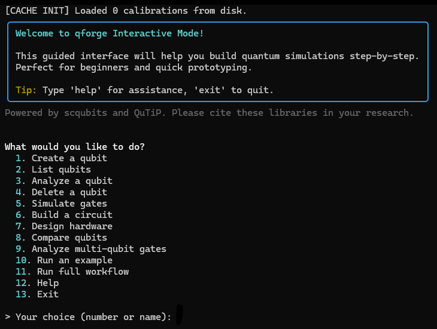

==========
Interfaces
==========

QubitWeave provides four front ends over the same engines: an interactive terminal
wizard, a desktop GUI, a scriptable CLI, and the Python API. None of them contains
physics. Each delegates to the engines described elsewhere in this documentation, so
anything available in the wizard is also available from a script.

Interactive mode
================

.. code-block:: bash

    $ QubitWeave --interactive

The wizard is built on prompt-toolkit and Rich. Move with the arrow keys and enter,
or start typing an option's name to filter. ``q``, ``Esc`` or ``Ctrl-C`` backs out
of a menu. Tab completes qubit names, file paths and coupling choices.

The menu
--------

**Qubits.** Create a qubit from a type and a preset, with the wizard prompting for
the parameters that model requires, or from a circuit designed under "Design a
device". List, analyze (spectrum, anharmonicity, coherence), compare several side by
side, or delete one along with its cached calibrations.

**Gates and circuits.** Simulate a one or two qubit gate and watch the populations
evolve, with the coupling type, pulse duration and noise model all adjustable.
"Analyze multi-qubit gates" benchmarks CNOT or CZ across coupling architectures and
strengths and prints a comparison table.

**Workflows.** Select the qubits, define the topology, supply an OpenQASM file, and
choose whether to run it unencoded or under a code. Error correction offers the
repetition, Steane and Shor codes, and warns before building a state vector large
enough to exhaust memory.

**Device design.** Start from one of nine templates or load an existing netlist, then
analyze it, display its schematic, sweep a parameter, or export the netlist. The
format reference is available from the same menu.

**Learn.** Run any of the bundled example scripts, or open the help page.

Graphical interface
===================

.. code-block:: bash

    $ QubitWeave --gui

The GUI is a tkinter application covering the same workflows as the wizard, with a
sidebar of actions and a console pane that reproduces Rich tables and plotext charts,
including their box-drawing characters. Selection dialogs are searchable, so a qubit
or template can be chosen from a filtered list rather than typed from memory.

It needs a desktop session. Everything else in QubitWeave runs headless.

Command line
============

For scripts, batch runs and CI, every workflow has a command. See :doc:`cli` for the
full reference.

.. code-block:: bash

    $ QubitWeave qubit create --type transmon --name Q1 --EJ 15 --EC 0.3
    $ QubitWeave qubit analyze --name Q1 --plot --coherence
    $ QubitWeave gate simulate --qubit Q1 --gate X --duration 40 --noise realistic

Python API
==========

The engines are the primary interface:

.. code-block:: python

    from QubitWeave.core.qubit_engine import QubitEngine
    from QubitWeave.core.gate_engine import GateEngine
    from QubitWeave.core.workflow_engine import PhysicalWorkflowEngine
    from QubitWeave.core.error_correction_engine import ErrorCorrectionEngine
    from QubitWeave.core.device_engine import DeviceEngine

Simulation methods return structured results rather than plotting, so they compose
into further analysis. See :doc:`quickstart` for a worked introduction and
:doc:`api` for the generated reference.

Try it in a browser
===================

The sandbox below runs on MyBinder with QubitWeave and its numerical backends already
installed, and requires no local installation.

.. note::

   Binder provisions a container on demand, so the terminal takes a moment to appear.
   Do not close or refresh the page while it loads.

1. Wait for Binder to finish. A terminal appears and boots straight into
   ``QubitWeave --interactive``.
2. Work through the menus. Arrow keys and enter, or type an option's name.
3. Tab completes qubit names and coupling choices.
4. Type ``exit`` or ``quit``, or press ``Ctrl-C``, to leave.

.. raw:: html

   

       <iframe src="https://mybinder.org/v2/gh/Ingenio17/QubitWeave/master?urlpath=terminals/1"
               style="position: absolute; top: 0; left: 0; width: 100%; height: 100%; border: 0; background: #1a1a1a;"
               allowfullscreen>
       </iframe>
   

